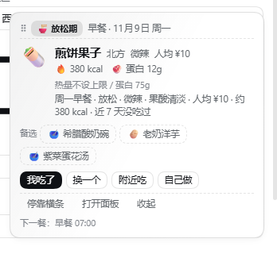

# dsh-today-eat 🍜 —— 你的 DSH 饮食管家

**A diet assistant for [DeepSeek Harness](https://github.com/deepseek-ai) (DSH).** Track taste preferences and meals, get phase-aware recommendations and reminders, search nearby restaurants, and cook from 1,000 locally-authored recipes — all data stays on your machine.

「今天吃什么」v2：给 DSH 用的饮食管家插件。

- **身份/口味档案**：家乡、常驻城市/区县、**酸甜苦辣咸鲜六维味道偏好**（0–5）、忌口、过敏、预算、厨艺。
- **九类饮食阶段**：🍚 少糖日常、🧂 清淡少盐、🍲 养胃、🥬 高纤维多吃菜、🏋️ 训练补给（减脂/增肌/维持/增重）、🌱 多吃素（蛋奶素/纯素/弹性素）、🤰 特殊时期（孕期备孕/银发/青少年）、🫖 养身体（病后/术后）、🎉 吃的高兴（日常犒劳/聚餐庆祝），每个阶段带热量/蛋白/自由餐目标；旧四阶段自动迁移。
- **饭点管家**：每天早/午/晚（可配夜宵）到点，输入框上方横条变成提醒态；可选系统通知、稍后提醒 30 分钟。
- **外食**：配置高德「Web 服务」Key 后，按你当前城市/区县搜 1.5km 内餐厅（距离/评分/人均）。**点单建议分两类**：连锁品牌按公开菜单给常见单品 + 阶段选法；查不到可靠公开菜单的小馆子明确让你到店看菜单、问招牌，不硬编推荐（[说明](docs/order-advice.md)）。
- **自制 + 菜谱库**：**1000 道本地原创菜谱**（覆盖全部菜品：中国 34 个省级行政区 + 日/韩/泰/越/印/美/意/法/墨/西/英/土耳其等国家菜），给做法、用量、预估热量/蛋白，并自动生成**菜市场采买清单**（按蔬菜/肉蛋/水产/豆制品/主食/调料/水果分组、给量）。
- **菜谱库页面**：面板第 5 个 tab「📖 菜谱」——搜索（菜名/食材/菜系）、场景筛选（快手 ≤20 分钟 / 高蛋白 / 汤羹 / 素菜）、**三维分类筛选与分组：按国家（16 国）/ 按菜系（11 类，云南菜单独成系）/ 按省份（34 个省级行政区）**，全部实时数量；卡片点开看用量分组、步骤、小贴士；每道菜附外部参考（下厨房/抖音/B站/小红书）。
- **我的菜谱**：菜谱库右上「➕ 添加我的菜」，填菜名 + 菜系（必填）及分类/省份/热量/蛋白/食材/步骤/小贴士；保存后带「我的」标签、排在最前，可搜索、可筛选「我的菜谱 N」、可展开、可删除；只存在本机 `state.userRecipes`，不参与推荐/周计划（[实现说明](docs/user-recipes.md)）。
- **外部做法参考**：菜谱底部一键打开 **下厨房 / 抖音 / B站 / 小红书** 的对应搜索页（手机通常唤起 App，桌面打开浏览器），同一道菜可对比不同人的做法；插件不抓取、不逆向这些 App 的接口，也不上传任何数据。
- **一周不重样**：滚动 7 天午/晚餐计划，可换菜、锁定某天；自动兼顾菜系/蛋白来源/蔬菜多样性与预算。
- **换一个风格**：推荐卡/面板「换一个」旁有「🎨 换一个风格」，可按菜谱大类多选（云南菜 / 川菜 / 粤菜 / 湘菜 / 江浙 / 北方 / 西北 / 西南 / 日韩 / 西式 / 快餐）；选后「换一个」只在所选菜系里抽，未选 = 全部菜系；选择会持久保存到本机状态。
- **长期记录**：吃过什么、喜欢/一般/不喜欢、花费；连续记录、不重样率、蛋白达标率、28 天热力图、**酸甜苦辣咸鲜六维口味画像统计**、导出 JSON。
- **给 AI 用**：`recommend_meal`、`plan_week`、`cook_plan`、`find_nearby`、`log_meal`、`meal_stats`、`update_profile` 七个工具 + `/food` 命令；你可以直接用一句话让 AI 改档案/做计划/记一餐。




---

## 安装

需要 DSH **0.2.2-rc.1 或更新版本**（本插件在 0.2.2-rc.1 上开发与验证；host 侧零 `@deepseek-ai/*` 依赖），Node **22.19+ / 24+**。

**从插件市场 / GitHub 安装（推荐）**

```text
# 插件管理页 → Add plugin → 填 GitHub 仓库地址，例如：
https://github.com/<owner>/dsh-today-eat

# 或 CLI（桌面版 profile 为 desktop，Web 版换成 web）：
dsh plugin add https://github.com/<owner>/dsh-today-eat
```

**从 npm 安装**（发布后可用）

```text
dsh plugin add dsh-today-eat
```

**本地开发 / 本机已装好时**

```text
# DSH 插件管理页 → Add plugin → 填：link:<你的插件目录>
dsh plugin --profile desktop add "link:<你的插件目录>"
```

安装后无需重启：host 半热加载，client bundle 由 DSH 热更新。
**卸载**：插件管理页移除 `dsh-today-eat`，或
`dsh plugin --profile desktop remove dsh-today-eat`。
卸载不会删除长期记录（`<DSH_HOME>/storages/dsh-today-eat/state.json`）。

> 想投稿到社区插件列表？见 [docs/marketplace.md](docs/marketplace.md)，里面包含发布清单、`screenshots.json` / 图标 / 条目 YAML 模板。

## 一分钟配置

打开任意会话 → 输入框上方横条点「打开面板」→ 右侧「今天吃什么」面板：

1. **设置 → 档案**：家乡/城市/区县/大区、**味道偏好六滑块（酸 / 甜 / 苦 / 辣 / 咸 / 鲜）**、忌口/过敏、素食、预算。
   （首次安装为空档案，按自己的情况填写；未设置城市时，附近搜索不会带城市限定）
2. **阶段**：在「饮食阶段」里选 🏋️ 训练补给 + 减脂（旧「健身期」会自动迁移过来）；也可以随时切换少糖日常 / 清淡少盐 / 养胃 / 高纤维多吃菜 / 多吃素 / 特殊时期 / 养身体 / 吃的高兴。
3. **饭点**：早 07:00–09:00、午 11:30–13:00、晚 17:30–19:30；可开「应用内提醒 / 系统通知」。
4. **高德 Key**（只影响「附近吃」）：按 [docs/amap-setup.md](docs/amap-setup.md) 申请「Web 服务」Key → 设置里粘贴保存。

也可以用对话：直接跟我说「我是湖南人，味道偏好酸 3 辣 5 鲜 4，在长沙，接下来 8 周减脂」，
我会调用 `update_profile` 落档；说「帮我排下周吃什么」「今晚自己做点什么」也会调对应工具。

## 每天怎么用

| 入口 | 说明 |
| --- | --- |
| 横条 | 显示阶段、当前/下一餐、推荐菜、热量/蛋白、备选；按钮：我吃了 / 换一个 / 换一个风格 / 附近吃 / 自己做 / 打开面板 |
| 面板 · 今天 | 餐次横幅（饭点窗口内显示「🔔 午饭时间到」）、营养 vs 目标、备选、**换一个风格（11 类菜系多选）**、附近餐厅、自制菜谱 + 采买清单 |
| 面板 · 本周 | 7 天午/晚安排（自制/外食标签）、重新规划、逐餐锁定、摘要（每餐均热量/蛋白、不重复菜、菜系、外食次数、预估花费） |
| 面板 · 菜谱 | 1000 道菜谱库 + **我的菜谱（添加/删除）**：搜索 + 场景筛选 + **国家 / 菜系 / 省份**三维筛选与分组（16 国 / 11 菜系，云南菜独立 / 34 省级行政区），点开看用量、步骤、外部参考 |
| 面板 · 记录 | 连续记录、不重样率、蛋白达标率、**六维口味画像（酸/甜/苦/辣/咸/鲜）**、28 天热力图、逐条评分/删除、导出 JSON |
| 面板 · 设置 | 档案/九阶段与子目标/饭点/提醒/高德 Key/数据说明 |

## 三种显示形态（可随时切换）

| 形态 | 样子 | 切换方式 |
| --- | --- | --- |
| 🪟 **浮窗（默认）** | 右下角浮动窗口（默认在小鲸鱼上方），可按住头部拖动到任意位置、可收起成「🍜 菜名」小胶囊，位置和收起状态自动保存 | 浮窗里点「停靠横条」可切回横条；设置 → 显示方式 → 浮窗 |
| 💬 **横条** | 输入框上方常驻一行，信息最紧凑，适合边聊边看 | 横条头部点「浮窗」；设置 → 显示方式 → 横条 |
| 📋 **仅面板** | 不显示任何浮层，只在右侧边栏「今天吃什么」面板里看（右下角不再占位） | 设置 → 显示方式 → 仅面板；需要时从右栏 tab 打开 |

- 切换会写入本机 host 状态（`ui.displayMode`），重启/换浏览器仍保持；设置里有「重置浮窗位置」。
- **自由拖动**：展开的浮窗**整张卡片任意空白处**按住就能拖（按钮/输入框区域仍正常点击），收起后的小球也能直接拖；拖动结束立即写回本机（刷新/重启保持坐标），4px 阈值避免误触；拖出屏幕会自动限制在视口内。
- **双击打开面板**：在浮窗任意空白处**双击**即可打开右栏「今天吃什么」面板；浮窗收起成小胶囊后，胶囊右侧有「▤ 面板」按钮，点它也能直接打开面板（胶囊主体仍是单击展开卡片）。
- **面板兜底**：在「插件 / 设置」等没有会话的页面、或右栏面板打不开时，点「▤ 面板」会改用插件自带的**全屏兜底面板**（同样四页，点 × / 按 Esc / 点遮罩关闭），保证任何页面都能看到数据面板。
- 浮窗在小窗口/分屏时会自动限制在视口内；拖动阈值 4px，避免误触按钮。
- 三档形态共享同一份推荐/记录逻辑，不会出现数据不一致。

## 九类饮食阶段

阶段分为「目标」和「吃饭场景」两类，可随时切换；旧四阶段（健身/健康/放松/放纵）会自动迁移，历史记录不丢。

| 阶段 | 子目标 | 默认目标 | 推荐倾向 |
| --- | --- | --- | --- |
| 🍚 少糖日常 | 稳糖 / 低 GI | 1700–2200 kcal / 蛋白 90g | 少糖少精制碳水、杂粮/豆类/蛋白质优先 |
| 🧂 清淡少盐 | 低盐 / 护心 | 1800–2200 kcal / 蛋白 90g | 少油少盐、清蒸/汤羹/白灼，少加工与蘸料 |
| 🍲 养胃 | 清淡养胃 / 易消化 | 1800–2200 kcal / 蛋白 90g | 粥/汤/面、软烂温和，少辣少炸少生冷 |
| 🥬 高纤维多吃菜 | 高纤 / 肠道友好 | 1700–2100 kcal / 蛋白 90g | 蔬菜、全谷、豆类、菌菇比例高 |
| 🏋️ 训练补给 | 减脂 / 增肌 / 维持 / 增重 | 减脂 1600–2000 kcal / 蛋白 120g；增肌 2600–3000 / 150g；维持 2000–2400 / 120g；增重 2800–3200 / 135g | 高蛋白低油、蒸煮烤、蔬菜足、少油炸/糖醋 |
| 🌱 多吃素 | 蛋奶素 / 纯素 / 弹性素 | 1800–2200 kcal / 蛋白 90–105g | 豆制品/菌菇/蔬菜/全谷；纯素会硬过滤动物性食材 |
| 🤰 特殊时期 | 孕期备孕 / 银发 / 青少年 | 孕期 2000–2400 / 蛋白 105g；银发 1800–2100 / 90g；青少年 2200–2600 / 105g | 少酒少生食、高汞鱼避开，蛋白与钙铁优先 |
| 🫖 养身体 | 病后 / 术后 | 2000–2400 kcal / 蛋白 113g | 软烂易消化、蛋白充足、少刺激 |
| 🎉 吃的高兴 | 日常犒劳 / 聚餐庆祝 | 不设热量硬上限 / 蛋白 68–75g | 火锅/烧烤/川菜/甜点，按心情与份量点 |

推荐打分同时叠加：**酸甜苦辣咸鲜六维**（用户偏好 vs 菜品派生画像）、菜系亲和（云南 + 川菜）、油腻接受度；
并避开近 7 天吃过的菜（14 天降权），所以「天天不重样」但仍是你会爱吃的东西。新阶段不重打 1000 道菜的数据标签，而是用营养/食材/标签/菜系动态算适配分，详见 [docs/phase-system.md](docs/phase-system.md)。

## Agent 工具

| 工具 | 作用 |
| --- | --- |
| `update_profile` | 更新家乡/城市/口味/忌口/预算/阶段（一句话即可） |
| `recommend_meal` | 按当前餐次/阶段/偏好推荐（含备选、营养、理由） |
| `plan_week` | 生成/重排 7 天午晚餐计划（可换 seed、锁菜） |
| `cook_plan` | 指定或自动选一道可做菜：菜谱步骤 + 用量 + 采买清单 + 花费 |
| `find_nearby` | 调高德搜附近餐厅 + 每家店的点单建议（连锁按公开菜单 / 小店自行点单）；未配 Key 时给可复制的兜底搜索词 |
| `log_meal` | 记录一餐（菜名/餐次/自制或外食/评分），返回最新统计 |
| `meal_stats` | 连续记录、重复率、蛋白/热量达标、**六维口味画像**、常吃菜系 |

`/food` 命令：`/food`、`/food 附近`、`/food 周计划`、`/food 自己做`、`/food 统计`。

## 数据存放与隐私

- 长期状态：`%DSH_HOME%/storages/dsh-today-eat/state.json`（默认 `C:\Users\<你>\.dsh\storages\...`）。
  端口随机的 Web GUI 不依赖 localStorage，换端口/换浏览器/重启都不丢；文件损坏会自动备份为 `state.json.bad-<时间戳>`。
- localStorage 只用于：v1 历史一次性迁移、当天已提醒去重、横条折叠状态、host 不可用时的离线兜底。
- 只在本机读写；**只有「附近吃」会联网**（高德 API，Key 只存本机状态文件，不写日志）。
- 记录可导出 JSON；数据删除即改 state 文件/面板逐条删除。

## 技术结构（DSH 0.2.2-rc.1）

- host 半：零 `@deepseek-ai/*` 依赖（link 安装解析不到），只用 node 内置 + 相对 import；`ctx.tools.register` 原始 JSON Schema 工具、`ctx.webServer.register` 注册 8 个 API 路由、`/food` 命令。
- client 半：经典脚本 `window.__ModuleLoader__.load({ id:'dsh-today-eat', factory })`，由 esbuild 打包（external: react/react-dom/jsx-runtime）；挂载 `conversation.input.dock` 横条 + 右栏 `sidebarRightTabs` 面板；样式用 `--dsw-alias-*` 主题变量。
- 共享内核 `src/core/`：纯函数（阶段目标/口味/评分/推荐/周计划/采买/饭点），host 工具与浏览器面板共用同一套逻辑。
- 数据：`data/dishes.js` **1000 道**（旧四维阶段兼容分/营养/酸型/产地/食材/国家/省份）、`data/recipes.js` **1000 道原创菜谱**（覆盖全部菜品；参考家常做法自行撰写，不抓取/不复制下厨房等平台内容）、`data/cities.js` 81 城；本轮扩容 500→1000（+500，分 5 批并行原创，原 500 道全部保留），并做同名去重（合并 24 组 + 改名 10 个变体 + 补 24 道新菜，见 `docs/dedupe-report.md`）；用户自建菜谱存 `state.userRecipes`（对象 map，最多 300 道，带 `custom` 标记，见 `docs/user-recipes.md`）。
- API：`GET/POST /dsh-today-eat/api/state`、`POST/DELETE .../meals`、`POST .../plan`、`POST .../amap-key`、`GET .../nearby`、`GET .../shopping`；写接口有同源 + 回环 + rev 并发校验。

## 构建与测试

本机没有全局 node，用 DSH 自带 runtime：

```powershell
$node = 'C:\Users\<你>\.dsh\dsh-runtimes\dsh-next-primary-runtime\dependencies\node\bin\node.exe'
$pnpm = 'C:\Users\<你>\.dsh\dsh-runtimes\dsh-next-primary-runtime\dependencies\pnpm\bin\pnpm.mjs'

& $node scripts/validate-data.mjs                     # 数据校验
& $node scripts/build-client.mjs                      # 生成 lib/client.js（CLI 改 client 后必须跑；host 文件保存即热加载）
& $node --test "tests/core/*.test.mjs" "tests/data/*.test.mjs" "tests/host/*.test.mjs"
& $node scripts/smoke-host.mjs                        # host 离线烟测（31 项）
& $node scripts/smoke-client.mjs                      # client 离线烟测（协议 / 纯函数 / 挂载点，36 项）
```

改菜单/菜谱：`data/dishes.js`、`data/recipes.js`；改算法：`src/core/`；改文案/UI：`src/client/`；改工具/接口：`lib/`。
client 改动后必须重新 `build-client.mjs`；host 改动后 DSH 会热加载（新增文件/模块图变化时可在插件管理页关开一次插件）。

## 已知限制

- 「附近」只给 POI + 点单建议，不保证今日菜单/库存/配送；要实时菜单需接外卖平台（不开放）。连锁建议来自本地维护的公开常见单品，菜单可能随门店调整，以门店为准；查不到菜单的店不会编菜名。
- 热量/蛋白是内置估算值，不是营养师处方；阶段目标可在设置里改。
- 菜谱为本地原创写法（1000 道，覆盖全部菜品与主要国家/省份）；不抓取第三方平台内容，外部参考以搜索深链形式提供。已完成同名去重：合并 24 组同地区重复、10 个跨地区/双版本改地区名，补入 24 道新菜后仍为 1000 道；处理记录见 [docs/dedupe-report.md](docs/dedupe-report.md)，近重复（地区变体）审计见 [docs/duplicate-audit.md](docs/duplicate-audit.md)，可用 `npm run check:duplicates` 复查。
- 「我的菜谱」只进菜谱库，暂不参与推荐/周计划/采买清单；不支持编辑，删除后需重新添加。
- 地址/餐厅数据来自高德，需自己申请 Key；Key 无效/配额用尽时附近会显示错误并给兜底搜索词。
- 记录与档案只在本机，不支持多设备云同步。
- 附近菜单/连锁单品为本地维护的公开信息快照，不会实时抓取；门店菜单可能调整，以门店为准；未识别的小店不会编造菜名。
- 菜谱库为纯本地静态数据，不随插件自动更新；新增/修改数据需发版。

## 版本

- v0.4.0：九阶段 + 子目标体系（少糖/少盐/养胃/高纤维/训练补给/多吃素/特殊时期/养身体/吃的高兴），旧四阶段自动迁移；动态阶段适配规则、阶段关键词与点单建议同步；测试 158 项。
- v0.3.0：首个公开发布版本；菜谱库扩到 1000 道（500→1000）、同名去重与 24 道补位、重复检查脚本与报告、插件市场元数据（MIT / 图标 / screenshots.json / 投稿模板）。
- v0.2.0：饮食管家（档案/阶段/饭点提醒/外食/自制菜谱+采买/菜谱库+我的菜谱/周计划/记录统计/7 工具）。
- v0.1.0：v1 单日推荐横条 + `recommend_meal` 工具 + `/food`（历史自动迁移）。

## License

[MIT](LICENSE)。菜谱文本为原创，参考的是家常做法通识，不复制第三方平台内容；高德 API 与第三方商标归各自权利人。
